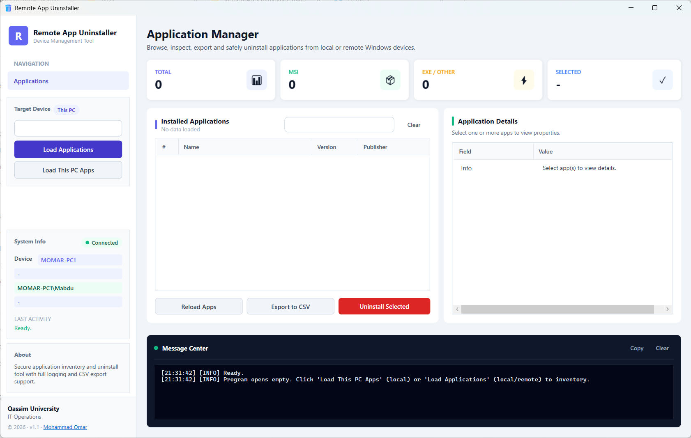

<div align="center">

# 📦 Remote App Uninstaller

**WPF GUI for Windows application management**

Browse, inspect, export, and silently uninstall applications on local or remote Windows machines. The tool picks silent switches, falls back to WinGet, and cleans up leftover files.

[](#-usage)
[](https://learn.microsoft.com/en-us/powershell/)
[](#%EF%B8%8F-requirements)
[](#%EF%B8%8F-usage)
[](#-license)
[](#-overview)

[Overview](#-overview) • [Features](#-core-features) • [Architecture](#%EF%B8%8F-architecture) • [Uninstall Engine](#-uninstall-engine) • [Requirements](#%EF%B8%8F-requirements) • [Troubleshooting](#-troubleshooting) • [License](#-license)

</div>

---

# 📖 Overview

Remote App Uninstaller is a WPF window for managing installed Windows applications. It reads the registry in both 64-bit and 32-bit views, filters the list as you type, shows full app properties, and runs uninstalls in background jobs on the local machine or over WinRM. It chooses silent switches for the installer type, tries WinGet if the normal uninstall fails, and removes leftover files where it can.

The whole tool is one file (`RemoteAppUninstaller.ps1`, about 3,300 lines). It needs no extra modules, config files, or installer.

---

## 🖼️ Screenshots



*Main window with the stats cards, filtered app list, property inspector, per-job progress rows, and Message Center.*

---

# 🚀 Quick Start

```powershell
.\RemoteAppUninstaller.ps1
```

Or bypass the execution policy:

```powershell
powershell.exe -ExecutionPolicy Bypass -File .\RemoteAppUninstaller.ps1
```

You can also double-click `RemoteAppUninstaller.exe`, which is a compiled launcher with no console window. The window opens empty. Click **Load This PC Apps** for the local machine or **Load Applications** for a local or remote target.

### Control Reference

| Control | Behavior |
|---|---|
| **PCNameBox** | Type a computer name/IP, or leave empty for the local machine. `Enter` triggers a load |
| **Load Applications** | Inventory the target from the box (local if empty) |
| **Load This PC Apps** | Inventory the local machine only |
| **Reload Apps** | Re-inventory the current target |
| **Export to CSV** | Save the currently filtered list to CSV |
| **Uninstall Selected** | Opens the confirmation dialog, then launches a background uninstall job |
| **SearchBox / Clear** | Live regex filter + reset |
| **Copy / Clear (Message Center)** | Copy all output to clipboard / wipe the log view |
| **Stop (per job)** | Cancels a running uninstall job |

### Keyboard & Mouse

* `Enter` in the PC-name box → **Load Applications**
* `Ctrl+C` or double-click on a details row → copies `Field: Value`
* Right-click a details row → **Copy Field** / **Copy Value**
* `Ctrl+click` in the app list → multi-select (comparison view)

---

# ✨ Core Features

### 🔹 Application Inventory
* Reads both registry views, `HKLM:\SOFTWARE\...\Uninstall` and `HKLM:\SOFTWARE\WOW6432Node\...`, locally or on a remote target
* Remote access uses `Invoke-Command` after an ICMP connectivity check
* Inventory runs in a `Start-Job`, so the window stays responsive. A progress overlay covers the wait, and the list refreshes after uninstalls

### 🔹 Live Sidebar & Stats
* The target card shows Connected or Offline, a This PC or Remote badge, and the device name, IP, logged-on user, OS version, and last activity
* Counters for total, MSI, other, and selected apps update whenever the selection changes

### 🔹 Search & Details Inspector
* A case-insensitive regex filter runs across Name, Publisher, and Version
* The property grid shows Publisher, Version, InstallDate, UninstallString, Product Code, Upgrade Code, Architecture, and about 30 more fields. Empty fields are hidden
* You can select several apps and compare their key fields side by side, and copy any field or row

### 🔹 Silent Uninstall Engine
* Detects MSI, Inno Setup, NSIS, Wise, InstallShield, and generic EXE installers
* Adds the right silent switches for each type (see [Silent Switch Mapping](#silent-switch-mapping))
* Splits each command into executable and arguments and runs it with `Start-Process`, not through a shell
* Runs each batch in its own `Start-Job` with a progress row and Stop button
* Rechecks the registry afterwards. If the app is still listed, it tries `winget uninstall --silent`
* Best-effort cleanup removes leftover registry keys, Program Files folders, Start Menu shortcuts, and AppData remnants

### 🔹 Export
* Saves the filtered list to CSV with a generated name in the form `<device>-<timestamp>-apps.csv`

---

# 📂 Project Structure

```text
RemoteAppUninstaller/
│
├── RemoteAppUninstaller.ps1      # WPF application source
├── RemoteAppUninstaller.exe      # Packaged executable
├── Screenshot.png                # Documentation screenshot
└── README.md
```

---

# 🏗️ Architecture

### Execution Model

```text
PowerShell (STA) ──► WPF Window (Dispatcher)
   │
   ├── LoadJob (Start-Job)      ──► writes to %TEMP%\...\load-<ts>.log
   │                                  └─ LoadTimer (300 ms) polls file → streams to Message Center
   │
   └── UninstallJob xN (Start-Job) ─► writes to %TEMP%\...\uninstall-<id>-<ts>.log
                                       └─ DispatcherTimer polls jobs → per-job progress rows, Stop buttons
```

On PowerShell 5.1, a background job cannot return output while it is still running. Each job therefore writes its lines to a log file, and the window polls that file with a timer to show progress as it happens.

### Code Regions (in file order)

| # | Region | Purpose |
|---|---|---|
| 01 | **ASSEMBLIES & GLOBALS** | WPF/WinForms references, script-scoped state, temp log dir |
| 02–03 | **XAML — MAIN WINDOW** | Window, sidebar, stats cards, app list, details pane, Message Center, job panels |
| 04 | **XAML LOADER (SAFE)** | `Load-XamlWindowSafe` — validates & loads XAML with descriptive errors |
| 05 | **CONTROL BINDING (SAFE)** | `Get-ControlOrFail` — fail-fast `FindName` |
| 06 | **TARGET HELPERS** | `Is-LocalTarget` — local vs remote detection |
| 08 | **SESSION INFO (SIDEBAR)** | Target badge, device card, OS/IP/user rendering |
| 09–11 | **UI HELPERS & LOGGER** | `Invoke-Ui` dispatcher wrapper, `Update-Output` color-coded output, `Set-LastAction` |
| 12 | **STATS (CARDS)** | `Update-Stats` — live Total/MSI/EXE/Selected counts |
| 13 | **DETAILS PANES** | Full property grid + multi-select comparison + copy helpers |
| 14 | **COLLECTION VIEW + FILTER** | `Set-AppList` / `Update-Filter` — CollectionView regex filtering |
| 15 | **GET-INSTALLEDAPPS** | Shared registry inventory scriptblock (local + WinRM) |
| 16 | **BACKGROUND INVENTORY LOAD** | `Start-LoadApps` + `LoadTimer` |
| 17 | **CONFIRMATION DIALOG** | Modal "Confirm Uninstall" window |
| 18 | **UNINSTALL SCRIPTBLOCK** | Background job: silent uninstall, verification, cleanup |
| 19 | **JOB POLLING** | `New-JobRow` / `Start-UninstallJob` + DispatcherTimer |
| 20–22 | **HANDLERS, EVENTS, INIT** | Button handlers, UI events, session setup, WPF message pump |

---

# 🔧 Uninstall Engine

### Silent Switch Mapping

| Installer | Detection | Switches appended |
|---|---|---|
| **MSI** | `msiexec` in the uninstall string | `/x <product-code> /quiet /norestart` (or convert `/i {guid}` → `/x {guid}`) |
| **Inno / NSIS / Wise / InstallShield** | `unins*.exe` in the path | `/VERYSILENT /SUPPRESSMSGBOXES /NORESTART` |
| **Generic EXE** | `.exe` and no silent flag present | `/S` |

The command is then split (`Split-UninstallCommand`) into executable and arguments and launched with `Start-Process`, without a shell.

### Per-App Removal Pipeline (`Remove-Application`)

1. **Reachability:** for remote targets, a quick ping check (skips unreachable hosts)
2. **Stop processes & services:** matching process names/descriptions and services are force-stopped (remote capped at 45 s)
3. **Run uninstall:** silent switches applied, run hidden with `-Wait`. **Remote:** runs via `Invoke-Command -AsJob` while the app is polled every 15 s for up to **4 minutes** (Inno uninstallers often linger; "gone from remote registry" counts as success). Elevation requests and exit codes surface in the log
4. **Verify:** registry re-checked for a matching `DisplayName` on the target
5. **WinGet fallback:** `winget uninstall --name "<name>" --exact --silent --accept-source-agreements --accept-package-agreements`
6. **Leftover cleanup:** registry keys, Program Files folders, Start Menu entries, AppData remnants (best-effort)

Each app produces `{ App, Status, Note, Details[] }` with `Status` of `Success` or `Failed`; a batch summary with app names is written to the Message Center.

### Data Model (Registry → App Object)

For every registry subkey with a `DisplayName`, the inventory produces an object including: `Name` (DisplayName), `Publisher`, `Version` (DisplayVersion), `InstallDate`, `UninstallString` (normalized: `/i {guid}` → `/x {guid}`), `QuietUninstallString`, `ModifyPath`/`RepairPath`, `InstallLocation`/`InstallSource`, `InstallSize`/`EstimatedSize`, `RegistryKey`, `ProductCode` (falls back to key name if `{GUID}`), `UpgradeCode`, `LanguageCode` (mapped to a friendly name), plus derived fields: `InstallerType` (MSI vs EXE/Other), `Architecture` (x86 via WOW6432Node / x64), `Scope`, and `Index`.

---

# 🧾 Logging

The dark Message Center streams everything with color-coded levels:

| Level | Color | Use |
|---|---|---|
| `INFO` | Grey-blue | General operations |
| `DETAIL` | Light blue | Workflow and connectivity details |
| `RESULT` | Blue | Success results |
| `WARN` | Yellow | Non-fatal warnings |
| `ERROR` | Red | Failures |
| `SUMMARY` | Green | Uninstall job summaries |

Raw log files:

```text
%TEMP%\RemoteAppUninstaller-Logs\
├── load-<yyyyMMddHHmmss>.log               # inventory
└── uninstall-<id>-<yyyyMMddHHmmss>.log     # each uninstall job
```

---

# ⚙️ Requirements

| Requirement | Details |
|---|---|
| **OS** | Windows 10 / 11 |
| **PowerShell** | Windows PowerShell 5.1+ with WPF (.NET Framework) |
| **Local usage** | Normal user rights for inventory; admin may be required for some uninstalls |
| **Remote usage** | WinRM enabled on target, remote management firewall rule open, admin rights on target |
| **Workgroup targets** | May require `TrustedHosts` or CredSSP configuration |
| **Optional** | WinGet CLI for the fallback uninstall |

### Remote Setup Checklist

```powershell
# On the target computer (as admin):
winrm quickconfig

# On the source computer (workgroup / non-domain, one-time):
Set-Item WSMan:\localhost\Client\TrustedHosts -Value "target1,target2" -Force
```

---

# 🔍 Troubleshooting

| Symptom | Fix |
|---|---|
| Script blocked by execution policy | `powershell.exe -ExecutionPolicy Bypass -File .\RemoteAppUninstaller.ps1` |
| Remote load reports unreachable | Check ICMP (firewall), then `Test-WSMan <host>` |
| WinRM access denied / not enabled | `winrm quickconfig` on the target + open the firewall rule |
| Uninstall of Program Files apps fails remotely | Ensure the remote WinRM session is elevated |
| No output while loading | Output streams via the live log file — check `%TEMP%\RemoteAppUninstaller-Logs\` |
| GUI seems slow on remote uninstall | Everything runs in jobs — watch the per-job progress rows |
| `UninstallString` empty | The app may not expose one; the tool logs a warning and still attempts cleanup |

---

# 🛡 Operational Notes

* Get permission before uninstalling software on machines you do not own or administer. The inventory data is sensitive as well
* Try silent switches on one pilot app before a batch run. Leftover cleanup is best-effort
* Some uninstalls, such as per-machine MSI and Program Files apps, need elevation. The tool reports elevation requests in the log
* Keep `TrustedHosts` limited to named targets and scope remoting firewall rules to your management subnet
* Per-job logs under `%TEMP%\RemoteAppUninstaller-Logs\` record every removal. Keep them under your change-management policy

---

## 📝 Changelog

| Version | Date | Notes |
|---|---|---|
| 1.1 | 2026-08-16 | Full reliability + UX overhaul (details below) |
| 1.0 | 2026-08-05 | Initial release |

### 1.1 — 2026-08-16

**Reliability / bug fixes**

* Fixed GUI crash **"Format specifier was invalid"**: `[math]::Floor()` doubles break `{0:d2}` time formats; values now cast to `[int]` first
* Fixed apps reported **Failed despite being removed**: `Test-AppStillInstalled` used `return` inside `ForEach-Object` (emits a truthy array, doesn't exit); rewritten with `foreach` + `break`
* Remote uninstalls **no longer hang or time out early**: `Invoke-Command -AsJob` + 15 s polling up to 4 minutes; elevation requests, missing executables, and exit codes surfaced in the log
* Process-stop phase **no longer hangs**: remote process stop wrapped in a job with a 45 s `Wait-Job` timeout; matching Windows services also force-stopped

**UX / UI**

* Live **"working m:ss"** elapsed indicator per job + indeterminate progress bar with 20 s heartbeats
* Batch **SUMMARY lists app names**: `SUMMARY: Completed on it-op-031 | Uninstalled: 1 (AnyDesk) | Failed: 0`
* Message Center readability: rule separators, bold violet app headers, indented `DETAIL` lines, SemiBold errors
* Button overhaul: hover/pressed overlays fill the entire button on every style; uniform 5 px radius; visible secondary-button border

---

## 🧭 Roadmap

* Export the details view alongside the CSV
* CredSSP / custom-credential support for domain remote uninstalls
* Per-app install-date sorting and grouping
* Refresh-before-uninstall sanity check (warn if the list is stale)

---

## 👤 Author

**Mohammad Abdelkader Omar**  
GitHub: [@mabdulkadr](https://github.com/mabdulkadr)  
Website: [momar.tech](https://momar.tech)  

---

## 📜 License

This project is licensed under the [MIT License](LICENSE).

---

## ⚠ Disclaimer

This skill and every script it generates are provided as-is with no warranty
of any kind. Test generated tools in a staging environment before deploying to
production. The authors assume no liability for any damage or data loss
resulting from their use.

---

<div align="center">

⭐ **If this tool saves you time, star the repo — it helps others find it.**

[Report an Issue](../../issues) · [momar.tech](https://momar.tech)

[](https://www.buymeacoffee.com/mabdulkadrx)

Built with [**PowerShell Enterprise Admin**](https://github.com/mabdulkadr/powershell-enterprise-admin)

</div>

## Running the GUI and building an EXE

This repository ships source scripts only. Run `Run-GUI.bat` from File Explorer, or start the `.ps1` file from an elevated PowerShell session. If you need a standalone executable, convert the script with [PSWrap](https://github.com/mabdulkadr/PSWrap) and re-sign the result on your own machine. Prebuilt EXEs are no longer committed.

---